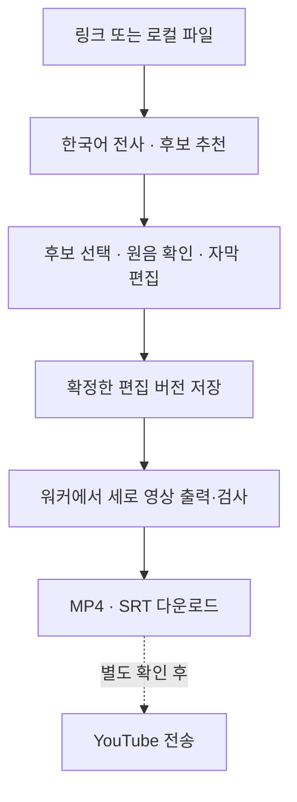
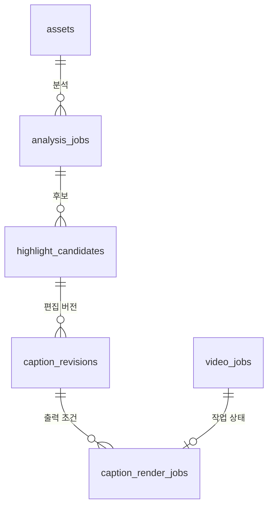

# Shortform Harness

Shortform은 긴 영상에서 공유할 장면을 찾아 세로 영상으로 만드는 도구입니다. 자를 위치를 알고 있다면 지정한 시각부터 10초를 추출할 수 있습니다. 장면을 찾아야 할 때는 한국어 음성을 글로 옮긴 전사를 바탕으로 후보를 추천받고, 원음을 들으며 자막을 고친 뒤 세로 MP4와 SRT 자막 파일을 내려받을 수 있습니다.

[프로젝트 Wiki](https://github.com/Juhye0k/short-form/wiki) · [제작실 사용 흐름](https://github.com/Juhye0k/short-form/wiki/05-development-complete-flow) · [구현과 검증 현황](https://github.com/Juhye0k/short-form/wiki/07-governance-status)

## 목차

- [어떤 서비스인가요](#어떤-서비스인가요)
- [사용 방법](#사용-방법)
- [핵심 흐름](#핵심-흐름)
- [서비스 아키텍처](#서비스-아키텍처)
- [ERD](#erd)
- [기술 스택](#기술-스택)
- [주요 기술 문서](#주요-기술-문서)

## 어떤 서비스인가요

긴 원본을 여러 번 재생하며 쓸 만한 구간을 찾는 작업과 자막을 다시 손보는 작업을 줄이는 것이 목표입니다. 추천 결과에는 후보 구간과 근거가 표시되며, 최종 장면과 자막은 사용자가 선택합니다.

| 하고 싶은 일 | 시작할 곳 |
| --- | --- |
| 시작 시각을 알고 있고 10초만 자르고 싶습니다. | [로컬 CLI](#로컬에서-첫-영상-추출) 또는 [웹 추출 화면](http://localhost:8000/extract) |
| 시간별 대사만 확인하고 싶습니다. | [제작실](http://localhost:8000/)에서 **음성 전사만 확인** 선택 |
| 후보를 골라 자막을 고치고 세로 영상으로 만들고 싶습니다. | [제작실](http://localhost:8000/)에서 **하이라이트 추천** 선택 |
| 완성본을 YouTube에 보내고 싶습니다. | [계정 연결·파일·게시 조건 확인](https://github.com/Juhye0k/short-form/wiki/05-development-youtube-upload) 후 전송 |

개발용 Compose에서 영상 입력부터 편집·다운로드까지 검사했습니다. 실제 검수본 한 건도 비공개로 게시해 Studio의 Shorts 분류를 확인했습니다. 해당 게시 제목은 사전 승인안과 달랐고, 같은 원본으로 다시 실행한 추천에서는 후보가 한 개였습니다. AI와 YouTube 전송은 기본 비활성화이며 운영 배포는 후속 과제입니다. [실제 검증과 남은 과제](https://github.com/Juhye0k/short-form/wiki/07-governance-status)

## 사용 방법

### 로컬에서 첫 영상 추출

Python 3.12, uv, FFmpeg와 FFprobe를 준비합니다. 입력이 YouTube 링크라면 Deno도 필요합니다. 아래 명령은 저장소 루트에서 공개 MP4의 5초 지점부터 10초를 자릅니다.

```powershell
uv sync --locked
uv run python -m app.cli.extract_clip --url "https://media.w3.org/2010/05/sintel/trailer.mp4" --start 5
```

성공하면 `.artifacts/video-runs/<실행 ID>/`에 검사 결과인 `result.json`과 결과 영상인 `output/clip.mp4`가 생성됩니다. DB나 Redis를 띄우지 않고 실행할 수 있습니다. [지원 입력과 추출 오류](https://github.com/Juhye0k/short-form/wiki/05-development-video-extraction)

### 브라우저에서 사용하기

Docker의 Linux 엔진을 켜고 저장소 루트에서 실행합니다.

```powershell
docker compose up --build -d
curl.exe -i http://localhost:8000/health/live
curl.exe -i http://localhost:8000/health/ready
```

두 응답이 200이면 API가 실행 중이고 DB·Redis에 연결됩니다. [추출 화면](http://localhost:8000/extract)에는 링크 또는 파일과 시작 시각을 입력합니다. 후보를 찾으려면 [전사·추천 제공자 설정](https://github.com/Juhye0k/short-form/wiki/05-development-groq-free-ai)을 적용한 뒤 [제작실](http://localhost:8000/)을 엽니다. API 요청 형식은 [로컬 Swagger UI](http://localhost:8000/docs)에서 볼 수 있습니다.

1. **입력·추천.** 링크 또는 검증된 로컬 파일로 추천을 시작하고 후보의 구간·점수·근거를 확인합니다.
2. **자막 편집.** 후보의 자막 편집기를 열어 원음을 듣고 문구·시각을 수정합니다. 확인한 편집 버전을 저장합니다.
3. **출력·다운로드.** **확정한 자막으로 영상 만들기**를 누르고 성공 상태가 표시되면 MP4와 클립 기준 SRT를 다운로드합니다.
4. **YouTube 전송.** 전송을 활성화했다면 채널, 파일, 제목, 공개 범위를 확인한 뒤 별도로 동의하고 전송합니다.

준비 응답이 503이거나 작업 진행이 멈추면 [개발 환경 점검](https://github.com/Juhye0k/short-form/wiki/06-operations-runbook)을 따릅니다. 파일로 시작할 때는 [형식·크기·길이 제한](https://github.com/Juhye0k/short-form/wiki/05-development-local-video-upload)을 확인하세요.

## 핵심 흐름

아래 그림에서 사용자가 **원음을 확인하고 저장하는 지점**이 출력의 기준입니다. 편집 내용을 바꾸면 새 버전을 저장해 그 버전으로 출력을 요청합니다.



*그림 1. 추천 제작의 작업 흐름입니다. 10초 추출에서는 추천과 편집을 건너뛰고 지정한 구간을 바로 처리합니다.*

## 서비스 아키텍처

FastAPI가 작업을 접수하고 브라우저에 조회에 사용할 번호를 돌려줍니다. Redis는 작업 번호를 전달하고, Celery 워커는 PostgreSQL에서 실행할 작업을 선점한 뒤 처리합니다. 워커가 영상을 저장하고 검사 결과를 기록하면 브라우저가 API를 통해 파일을 받습니다.


*그림 2. 상태와 편집 버전은 PostgreSQL에, 원본과 결과 영상은 저장 볼륨에 남습니다. Redis에는 작업 번호와 최소 메타데이터를 전달합니다.*

[구성도 확대](docs/architecture.svg) · [10초 추출 요청의 실행 순서](https://github.com/Juhye0k/short-form/wiki/03-architecture-system-overview#10초-추출-요청은-어디를-거치나) · [Celery·Redis를 선택한 이유](https://github.com/Juhye0k/short-form/wiki/04-decisions-adr-003-redis-celery)

## ERD

ERD는 데이터베이스 테이블과 관계를 보여 줍니다. 추천 제작에서 원본 자산이 분석, 후보, 편집 버전, 영상 출력으로 이어지는 관계를 발췌했습니다.



*그림 3. 서로 다른 출력 조건을 같은 편집 버전에 연결할 수 있습니다. `caption_render_jobs`가 편집 버전과 실제 출력 작업을 잇습니다.*

| 찾으려는 데이터 | 관련 테이블 |
| --- | --- |
| 원본 영상과 저장 전사 | `assets`, `transcripts` |
| 분석 상태와 추천 후보 | `analysis_jobs`, `highlight_candidates` |
| 편집 버전과 출력 상태 | `caption_revisions`, `caption_render_jobs`, `video_jobs` |
| 연결한 채널과 전송 상태 | `sns_accounts`, `sns_uploads` |

[DB 모델](app/models.py) · [스키마 변경 이력](migrations/versions) · [데이터와 비동기 작업 계약](wiki/03-architecture/data-and-jobs.md)

## 기술 스택

| 영역 | 기술과 역할 |
| --- | --- |
| 웹·API | HTML·CSS·JavaScript, Python 3.12, FastAPI |
| 데이터 | PostgreSQL에 업무 상태를 저장하고 SQLAlchemy·Alembic으로 조회와 스키마 변경을 관리합니다. |
| 비동기 처리 | Redis가 작업을 전달하고 Celery 워커가 분석·영상 출력·SNS 전송을 맡습니다. |
| 영상 처리 | yt-dlp로 공개 YouTube 입력을 가져오고 FFmpeg·FFprobe로 영상과 음성 트랙을 인코딩·검사합니다. |
| AI·SNS 연동 | Groq, Azure Speech, OpenAI는 설정에 따라 전사·추천에 사용합니다. YouTube 연결은 Google OAuth와 YouTube Data API를 사용합니다. |
| 개발·검증 | uv, Docker Compose, Ruff, pytest, Playwright, GitHub Actions |

## 주요 기술 문서

| 궁금한 점 | 읽을 문서 |
| --- | --- |
| 접수 응답과 처리 완료는 어떻게 구분하나요? | [API 요청·응답과 오류](https://github.com/Juhye0k/short-form/wiki/03-architecture-api-contract) |
| 추천 후보가 한 개만 나왔을 때 무엇을 확인하나요? | [제안·채점·선정 단계와 관측 기록](https://github.com/Juhye0k/short-form/wiki/05-development-highlight-recommendations) |
| 원본 자막이 있는 영상에서는 왜 편집 자막을 일부 숨기나요? | [969프레임과 SRT로 자막 중복을 확인한 기록](https://github.com/Juhye0k/short-form/wiki/05-development-harness-records-2026-11-18-final-output-e2e) |
| 어떤 검사에서 실제 워커와 브라우저를 실행하나요? | [기본·통합·브라우저 검사](https://github.com/Juhye0k/short-form/wiki/05-development-harness-verification) |
| 작업이 멈추거나 응답이 사라지면 무엇을 봐야 하나요? | [장애 대응과 수동 중단 확인](https://github.com/Juhye0k/short-form/wiki/06-operations-runbook) |

로컬 기본 검사는 저장소 루트에서 실행합니다.

```powershell
uv run python scripts/verify.py
```

Ruff 검사, 기본 테스트와 Alembic 오프라인 SQL 생성을 수행합니다. 일반 CI의 통합 검사는 AI·YouTube를 테스트 대역으로 연결하므로 실제 모델 품질과 계정 게시 결과는 [구현과 검증 현황](https://github.com/Juhye0k/short-form/wiki/07-governance-status)에서 확인합니다.
