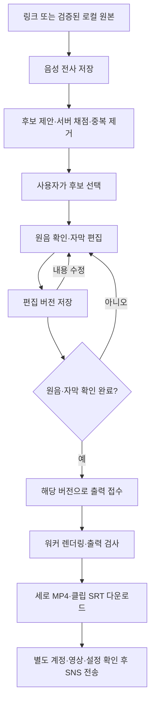

# 입력부터 자막 편집·출력·YouTube까지 — FLOW-001

> 추천 후보를 고른 뒤 자막을 수정하고 확인한 버전으로 세로 영상을 출력할 수 있습니다. 입력·편집·다운로드·YouTube 연결을 따라가며 버전 고정과 사용자 확인이 필요한 지점을 설명합니다.

영상 입력부터 후보 선택·자막 편집·세로 영상 다운로드까지 한 번에 따라가는 안내다. 먼저 원음을 확인해 편집 버전을 저장하고, 그 버전으로 출력한다. YouTube 게시 동의는 마지막에 별도로 받는다.


## 사용자 선택과 저장 버전의 관계



원본 전사와 편집 버전은 분리합니다. 편집을 바꾸면 이전 출력은 숨기고 새 버전을 저장해야 합니다. 같은 확정 버전과 출력 조건을 보내면 기존 작업을 재사용합니다. SNS 전송은 별도로 승인합니다.


## 장면을 이미 알고 있다면

`/extract`에서 시작 시각을 넣으면 10초를 자릅니다. 새로고침하면 저장한 작업 번호로 상태를 다시 조회합니다. 통신 오류가 뜨면 같은 번호를 조회하세요. 추출 접수를 다시 보내면 별도 작업이 생깁니다. 아래 제작실 단계는 장면을 추천받아 편집할 때 사용합니다.

## 사용자 흐름

쇼츠 제작실의 작업 메뉴에서 **새 쇼츠**와 **내 프로젝트**를 열 수 있다. 프로젝트 카드에는 분석 상태와 후보 수가 표시된다. 추천 화면은 후보 목록, 구간 미리보기, 편집·다운로드 동작을 배치한다. 휴대전화에서는 세 영역이 세로로 이어진다.

| 순서 | 사용자가 하는 일 | 서비스가 하는 일 | 다음으로 넘어갈 조건 |
|---|---|---|---|
| 1 | 홈 쇼츠 제작실에서 링크나 파일을 넣고 추천 시작 | 원본을 준비하고 분석 접수 | 추적할 분석 ID가 생성됨 |
| 2 | 프로젝트를 열고 후보의 영상·점수·근거 비교 | 내 프로젝트에서 기존 분석과 상태를 복원하고 선택한 구간을 재생 | 분석 성공·후보 존재 |
| 3 | 후보의 **자막 편집** 클릭 | 준비된 화면 정렬 초안 또는 저장 전사 초안 표시 | 해당 후보의 편집 화면이 열림 |
| 4 | 문구·시간·줄바꿈 수정, 원음 확인 | 표시 규칙 검사·편집 버전 저장 | 사람이 확인한 버전이 저장됨 |
| 5 | **확정한 자막으로 영상 만들기** 클릭 | 워커가 인코딩·출력 검증 | 출력 작업 성공 |
| 6 | 편집기 또는 프로젝트에서 MP4·클립 SRT 다운로드 | 권한·성공·편집 버전 일치를 확인하고 완료 파일 제공 | 원하는 구간·자막이 결과에 반영됨 |
| 7 | 필요하면 **YouTube 업로드** 이동 | 선택한 출력과 추천 제목을 불러오고 채널·공개 범위·아동용 설정 미리보기 제공 | 별도의 게시 동의 후 전송 |

편집기에서 프로젝트로 돌아가면 선택한 후보가 유지된다. 게시 화면에서는 파일을 만든 편집 버전으로 돌아갈 수 있다. 10초 추출은 `/extract`에 있다. 기존 `/?job=…` 추출 주소도 열 수 있다.

분석을 접수하면 프로젝트 주소에서 서버 단계와 진행률을 표시한다. 퍼센트는 도달한 단계에 따라 바뀌며 각 단계의 소요 시간은 입력과 제공자 응답에 따라 달라진다. 새로고침이나 프로젝트 재방문은 같은 분석 상태를 읽는다. 분석이 완료되면 100%와 결과를, 실패하면 실패 단계와 오류를 표시한다. 채점이 제공자 요청 한도에 걸린 경우 이미 저장된 전사와 자막을 같은 화면에서 확인할 수 있다.

실제 분석은 기존 제공자 설정과 키를 사용한다. 무료 모드·한도·모델 접근 거부를 우회하거나 유료 제공자로 자동 전환하지 않는다. 실제 서비스에서 후보 생성이 실패하면 편집 단계로 넘어가지 않는다. 설정은 [Groq 안내](groq-free-ai.md)를 따른다.

FLOW-001의 첫 검사 범위는 링크 입력 하나, 추천 후보 하나, 고정 세로 스타일 하나, YouTube 하나다. 로컬 파일 입력은 [별도 업로드 기능](local-video-upload.md)으로 추가했다. 드래그 타임라인·스타일 템플릿·다른 SNS는 후속이다.

## 자막을 확인하고 저장하는 과정

자동 초안은 편집의 출발점이다. 단어 시간이 부족하면 화면에서 재생하며 경계를 확인해야 한다. 먼저 문구·시각을 고치고, 원음을 확인한 뒤 저장한다. 검사 조건을 통과했다는 이유만으로 ‘원음 확인’ 체크를 대신하지 않는다.

편집 시간은 선택 클립의 0초부터 표시하지만 API·DB는 원본 기준 정수 밀리초를 사용한다. 전사에서 검증된 단어 시간이 있는 구간만 자동 분할하며, 부족한 구간의 긴 문구·시간은 사용자가 직접 나눈다. 균등한 시간 배분이나 요약으로 부족한 전사를 감추지 않는다. 추천의 최소 전사 데이터에 단어 정보가 없으면 저장된 전사 버전에서 해당 ID의 원문을 읽는다.

원본에 맞는 화면 관측이 준비된 분석은 화면 전환에 가까운 단어 시각을 분할에 쓴다. 편집기에서 원본을 재생해 문구와 시간을 확인할 수 있고, 직전 저장본을 새 탭에 열어 비교할 수 있다. [화면 관측 준비와 전사 초안으로 돌아가는 조건](source-caption-evaluation.md).

수동 편집은 `shorts-display-v1`과 같은 1~3어절·줄당 14자·최대 2줄·0.45~1.8초·15자/초 기준을 검사한다. 범위 초과·역전·겹침·ASS 제어문자·모르는 원 구간 ID를 거절한다. 모든 후보 원 구간이 최소 한 개 자막에 연결돼야 확인 완료로 저장할 수 있다. 문구의 의미·실제 발화 시각 일치는 사람의 검수이며 이 검사만으로 보장하지 않는다. 무음 구간은 자막으로 채우지 않아도 된다.

저장은 원본 전사와 별도의 `caption_revisions` 불변 스냅샷이다. 같은 후보·전사 버전·문구·시간·확인 상태는 같은 버전을 재사용한다. 확인 전 스냅샷은 저장할 수 있으나 출력할 수 없다. 기존 `ok/error` 전사 판정이나 CER 결과를 대신하지 않는다. 이 확인은 실제 SNS 게시 동의와 별개다.

편집 버전을 URL에 넣어 새로고침해도 같은 내용을 복원한다. 변경 후에는 이전 출력·업로드 링크를 숨기고 다시 저장하도록 한다. 저장할 때 조회한 최신 버전 ID를 함께 보내므로 다른 편집이 먼저 저장되면 서버가 충돌을 알린다. 일반적인 미저장 편집은 새로고침 시 복원하지 않는다. 저장 응답이 끊긴 내용은 임시 보관하고 조회로 확인한다. 자동 저장·전체 버전 목록·자유로운 클립 범위 편집은 후속이다.

## API와 실행 경계

| 요청 | 역할 |
|---|---|
| `GET /analyses?limit=12&offset=0` | 로그인한 계정의 프로젝트 목록과 후보 수, 작업 상태 조회. 인증을 끈 개발 환경에서는 로컬 자료를 표시한다. 원본 URL·전사는 목록 응답에 포함하지 않는다. |
| `GET /analyses/{a}/candidates/{c}/editor` | 후보·선택 원 전사·자동 초안·정렬 상태·최신 저장본·직전 버전 조회 |
| `GET /analyses/{a}/source-video` | 보존 원본의 읽기 전용 Range 재생 |
| `POST /analyses/{a}/candidates/{c}/caption-revisions` | 표시 제약 검사·별도 버전 저장. `expected_latest_revision_id` 지정 시 최신 버전 비교 |
| `GET /analyses/{a}/candidates/{c}/caption-revisions/{r}` | 해당 후보의 불변 버전 조회 |
| `POST /analyses/{a}/candidates/{c}/caption-revisions/{r}/exports` | 확정 버전의 비동기 출력 접수·기존 작업 재사용 |
| `GET /jobs/{j}` / `download` / `subtitles.srt` | 상태·검증 MP4·클립 기준 SRT 조회 |

편집 버전은 `0006_caption_revisions`에서 도입했다. `0009_caption_render_jobs`는 편집 버전과 출력 프로필·확인한 원본 자막 구간을 작업에 연결한다. 같은 후보의 일반 클립 추출과 기존 v1 작업·다운로드도 보존한다. PostgreSQL이 후보·버전을 잠가 같은 입력의 작업을 한 번 만들고, 기존 Redis/Celery 큐와 워커가 처리한다. HTTP 요청 시 인코딩과 자동 재시도를 수행하지 않는다.

워커는 확정 버전과 자산·구간의 일치 및 원본 해시를 확인하고 720×1280 MP4를 만든다. 현재 `portrait-edited-v2`는 원본 화면 전체를 유지하고 새 자막을 바로 아래 자막 띠에 표시한다. 이전 프로필의 결과가 있는 확정본은 기존 파일과 지금의 화면 구성 중 선택할 수 있다. 길이 ±0.1초·필수 트랙·전체 디코딩·해상도·정사각형 픽셀·원본 보존을 검사한 뒤 파일을 제공한다.

원본 영상 안에 이미 자막이 있으면 편집기에서 **원본 자막 구간 추가**를 눌러 실제로 확인한 시작·종료 시각을 클립 기준 초로 입력한다. 해당 구간의 새 자막을 미리보기와 MP4에서 생략하고, 다운로드용 SRT에는 전체 검수 자막을 담는다. 출력 작업에 구간을 저장하므로 같은 결과를 다시 열면 표시 설정도 복원된다.

출력 API에 원본 해시와 자막이 이미 보인다고 확인한 구간을 함께 보내면 그 구간에서만 새 자막을 숨긴다. 일반 편집기 출력은 확정 자막 전체를 표시하는 기본값을 사용한다. SRT에는 모든 확정 자막을 담고 원본 시간에서 클립 시작을 뺀다. [출력 프로필과 관측 범위](harness/records/2026-11-18-flow-output-layout.md).

작업 발행·워커 중단 후 pending/running 자동 복구는 기존과 같이 없다. 실패 버전에 대한 재요청은 기존 실패 작업을 반환하며 새 인코딩을 조용히 만들지 않는다. 조회 통신 오류와 실제 처리 실패를 구분한다.

## 권한·게시·삭제

편집·원본·버전 API는 분석 ID 아래 두어 기존 소유권·만료·사용 기록 경계를 통과한다. 후보와 버전도 분석에 속하는지 서버가 검증한다. 편집 출력은 원본의 소유자와 만료 시각을 상속한다. 자산 삭제 시 후보와 자막 버전도 FK cascade로 제거하며 별도 출력 삭제는 자산의 편집 프로젝트까지 지우지 않는다. 실제 자료 삭제를 테스트 입력과 혼동하지 않는다.

YouTube에는 최종 출력의 작업 ID를 전달한다. 기존 SNS 확인은 계정·파일 해시·제목·공개 범위·아동용 여부에 묶이고 사용자 확인 전에는 전송하지 않는다. 새로고침·중복 클릭·미확정 전송에 대한 기존 중복 방지를 유지한다. 일반 CI는 실제 Google·YouTube 계정에 접근하지 않는다.

## 엔드투엔드 검사와 하네스

```powershell
uv run python scripts/verify.py
docker compose -f compose.integration.yaml up --build -d api worker analysis-worker sns-worker
docker compose -f compose.integration.yaml run --rm runner
```

전체 integration은 편집부터 다운로드와 SNS 대역 전송까지 연결하고, 화면 정렬 자료 유무·동시 저장·이전 출력 버전과의 호환을 검사한다. 외부 다운로드·AI·OAuth/YouTube는 고정 합성 대역으로 바꾸고 실제 HTTP·DB·Redis·Celery·FFmpeg·Chromium을 연결한다. 실제 영상의 음성 인식·추천 품질은 별도 표본으로 확인한다.

전체 흐름에서 문구 수정·확정·저장·새로고침·렌더링·실제 파일 다운로드·SNS 확인·대역 업로드를 수행한다. 원본 전사 보존, 화면의 요청 수, 서버의 동일 버전 작업 재사용, 출력 해상도·길이·음성, SRT 문구, 다운로드와 전송한 바이트의 SHA-256 일치를 확인한다. 같은 버전의 중복 선점, 확인 전 출력 차단, 다른 후보 버전·다른 사용자 접근 거절과 자산 삭제 시 자막 제거도 검사한다.

전체 흐름은 성공·실패 모두 테스트 영상 볼륨의 `/data/e2e/complete-flow/<실행 ID>/`에 Playwright `trace.zip`을 남긴다. 실패 스크린샷과 성공 요약·MP4도 해당 폴더에 쓴다. 실행마다 다른 폴더를 사용해 이전 실패 화면을 새 실행의 증거로 오인하지 않는다. 테스트 환경을 정리하기 전에 API 컨테이너에서 이 폴더를 Git 제외 산출물로 복사한다.

CI는 integration 실행 후 정리 전에 E2E 자료를 tar로 복사하고, 합성 MP4는 제외한다. `actions/upload-artifact@v7`로 trace·스크린샷·성공 요약을 7일 보관하도록 설정했다. [공식 입력 안내](https://github.com/actions/upload-artifact)를 확인했다. 원격 CI 실행 성공은 별도 확인 대상이다. 이 경로에는 테스트 합성 입력만 사용하며, 실제 사용자 원본·전사·토큰이 포함된 trace를 공개 CI나 Wiki에 올리지 않는다. 증거 수집 성공이 업무 검사 실패를 통과로 바꾸지 않는다.

테스트 전용 `/demo`는 합성 데이터·AI/YouTube 대역임을 화면 상단에 계속 표시하며 샘플 링크 입력·데모 채널 연결을 제공한다. production 앱에는 이 경로가 없다. 로컬 체험에서는 SNS_ORIGIN을 실제 호스트 주소에 맞추고 기존 개발 DB·계정·키를 공유하지 않는다. `SHORTFORM_DEMO=1`은 이 대역 환경에서만 SNS의 같은 출처 iframe을 허용한다. 기본 SNS의 프레임 차단 정책은 유지한다. 이 리허설이 실제 AI 품질이나 실제 계정 업로드의 증거는 아니다.

실행 결과와 발견한 결함은 [작업 기록](harness/records/2026-11-17-complete-flow.md)에 갱신한다. 실제 모델의 접근 거부·자막 인식률·추천 적합도, 실제 편집 결과의 계정 게시, Safari·모바일 실기기·부하 검사는 별도다.

<details>
<summary>작성 시점과 상태 이력</summary>

> 상태: 로컬 구현·대역 E2E 검증 완료 · 기준일: 2026-11-17

</details>
